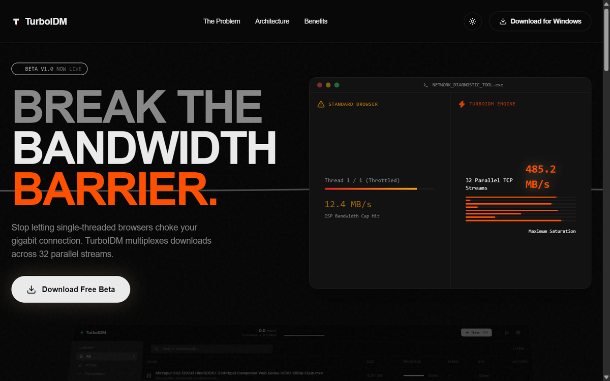
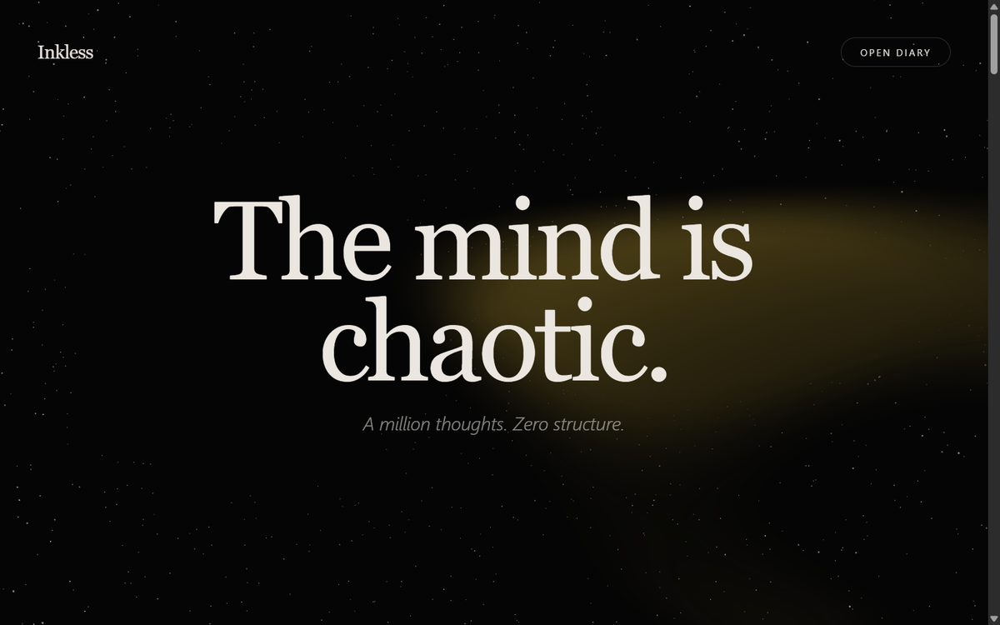
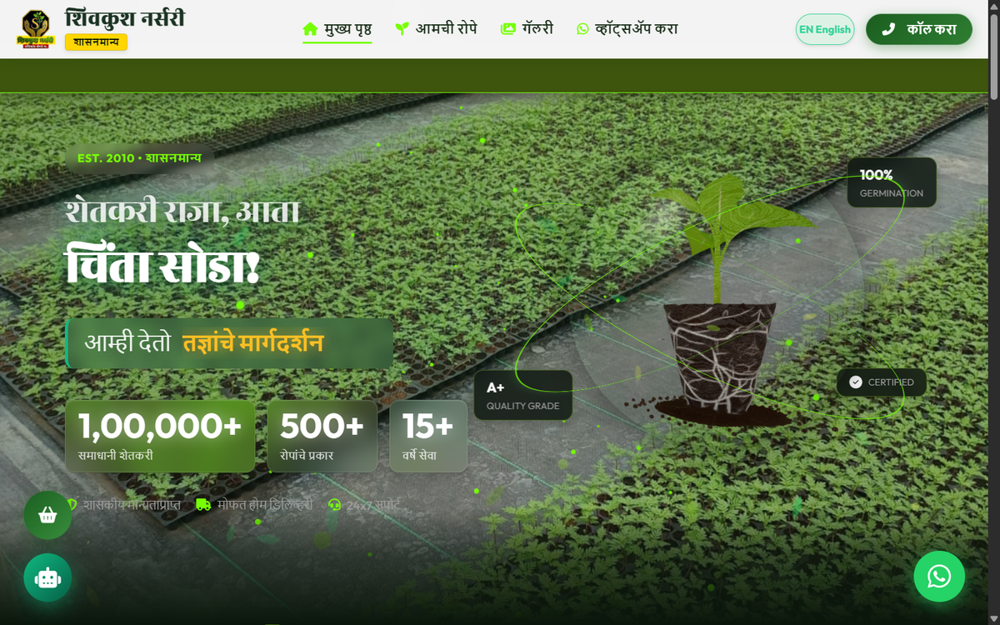

<div align="center">



</div>

<br>

> *I explore technology, experiment with ideas, and build software that turns interesting problems into useful experiences. Based in Pune, India, focusing on software & systems with an emphasis on speed, clean interfaces, and solving real user problems.*

<br>

<div align="center">
  
</div>

<br>

### SELECTED WORKS

A collection of applications and tools I've designed and built — focusing on speed, clean interfaces, and solving real user problems.

<br>

#### 01 // TURBOIDM
**Desktop App & Chrome Extension · Fast, Parallel Download Manager**

<br>

<div align="center">
  <a href="https://turbo-idm.vercel.app/" target="_blank">
    
  </a>
</div>

<br>

A fast download manager and browser extension that speeds up large downloads up to 8x by downloading file parts simultaneously and saving directly to disk without slow merge times.

```
HIGHLIGHTS      Up to 8x Faster Downloads · Instant File Completion · 32 Parallel Streams
STACK           Node.js · Electron · React 19 · Chrome MV3 Extension · TypeScript
LINKS           https://turbo-idm.vercel.app · https://github.com/Yashvardhan-4
```

<br>

<div align="center">
  
</div>

<br>

#### 02 // INKLESS
**Web Application & Graphics · Distraction-Free Journal that Works Offline**

<br>

<div align="center">
  <a href="https://inkless-ashen.vercel.app/" target="_blank">
    
  </a>
</div>

<br>

A fast, distraction-free writing app that saves your notes instantly to your device so you never lose your work, even when you're completely offline.

```
HIGHLIGHTS      < 5ms Instant Local Save · Zero Data Loss · 120 FPS Fluid Visuals
STACK           Next.js · React · IndexedDB · Supabase · Three.js · GLSL Shaders
LINKS           https://inkless-ashen.vercel.app · https://github.com/Yashvardhan-4/Inkless
```

<br>

<div align="center">
  
</div>

<br>

#### 03 // SHIVKUSH NURSERY
**Real-World Business Tool · Online Plant Store & Business Management**

<br>

<div align="center">
  <a href="https://shivkush-hi-tech-nursery.vercel.app/" target="_blank">
    
  </a>
</div>

<br>

A bilingual online plant store and inventory management system built for a commercial agriculture nursery, designed to load fast even on slow mobile networks.

```
HIGHLIGHTS      Fast on 2G/3G Networks · 84% Smaller 3D Models · Zero Stock Conflicts
STACK           Next.js · Three.js · Google Draco · PostgreSQL · Tailwind CSS
LINKS           https://shivkush-hi-tech-nursery.vercel.app · https://github.com/Yashvardhan-4
```

<br>

<div align="center">
  
</div>

<br>

### TECHNICAL TOOLKIT

Technologies and systems I work with:

```
LANGUAGES & RUNTIMES      TypeScript · JavaScript · C++ · Python · Node.js · SQL
FRAMEWORKS & FRONTEND     React 19 · Next.js · Three.js · Tailwind CSS · Electron
STORAGE & INFRASTRUCTURE  PostgreSQL · Supabase · IndexedDB · Docker · Git
EXPLORATIONS              WebGL · GLSL Shaders · 3D Draco Compression · Chrome MV3
```

<br>

---

### PROFILES & CONNECT

```
PORTFOLIO       https://www.yashvardhanborude.tech
GITHUB          https://github.com/Yashvardhan-4
LINKEDIN        https://linkedin.com/in/yashvardhan-borude-8640a6319
LEETCODE        https://leetcode.com/u/yashvardhan_4
CODEFORCES      https://codeforces.com/profile/yashvardhanborude7
EMAIL           yashvardhanborude7@gmail.com
```

<br>

<div align="center">
<sub>Pune, India · Curiosity, made tangible.</sub>
</div>
