<!-- 1. HEADER ANIMATION & AVATAR -->

  
  

  

<!-- 2. CUSTOM ABOUT ME TERMINAL -->

  

 

<!-- 3. CATEGORIZED TECH STACK VIA SKILLICONS -->

  

  

  

<!-- 4. REAL-TIME SYSTEM METRICS -->

  

  
  

 

<!-- 5. CONTRIBUTION METRICS -->

  

 

<!-- 6. ANIMATED FOOTER & SNAKE GAME -->

  

  <a href="https://github.com/Yashvardhan-4">
    <picture>
      <source media="(prefers-color-scheme: dark)" srcset="https://raw.githubusercontent.com/Yashvardhan-4/Yashvardhan-4/output/github-contribution-grid-snake-dark.svg">
      <source media="(prefers-color-scheme: light)" srcset="https://raw.githubusercontent.com/Yashvardhan-4/Yashvardhan-4/output/github-contribution-grid-snake.svg">
      
    </picture>
  </a>

  

 

<!-- 7. AESTHETIC ENDING GIF -->

  

