<!-- 1. GHIBLI PANORAMIC HEADER BANNER -->

  

<!-- 2. ANIMATED AVATAR & DYNAMIC TYPING SVG -->
<table border="0" cellspacing="0" cellpadding="0" style="border: none; background: transparent;">
  <tr style="border: none; background: transparent;">
    <td align="center" valign="middle" style="border: none; padding: 10px;">
      
    </td>
    <td align="center" valign="middle" style="border: none; padding: 10px;">
      
    </td>
  </tr>
</table>

 

> *🍃 "The wind is rising... we must try to live." — Hayao Miyazaki*
> 
> *Curiosity, made tangible. Crafting quiet, useful software, spatial WebGL graphics, and high-velocity algorithmic systems.*

 

<!-- 3. HIGH-DENSITY DEVELOPER CONSOLE -->

  

 

<!-- 4. INFINITE ANIMATED TECH STACK CAROUSEL -->

  

  

 

<!-- 5. VERIFIED GITHUB TELEMETRY & LANGUAGE BREAKDOWN (ZERO-DOWNTIME NATIVE SVG) -->

  

  

  

 

<!-- 6. CONTRIBUTION SNAKE GAME & ACCESS COUNTER -->

  

  <a href="https://github.com/Yashvardhan-4">
    <picture>
      <source media="(prefers-color-scheme: dark)" srcset="https://raw.githubusercontent.com/Yashvardhan-4/Yashvardhan-4/output/github-contribution-grid-snake-dark.svg">
      <source media="(prefers-color-scheme: light)" srcset="https://raw.githubusercontent.com/Yashvardhan-4/Yashvardhan-4/output/github-contribution-grid-snake.svg">
      
    </picture>
  </a>

  

 

<!-- 7. CODING PROFILES & DIRECT CONNECT -->

  
  &nbsp;
  
  &nbsp;
  
  &nbsp;
  

 

<!-- 8. GHIBLI TRANQUIL LAKESIDE FOOTER -->

  

  ✦ Pune, India · Crafted with quiet purpose under open skies ✦

